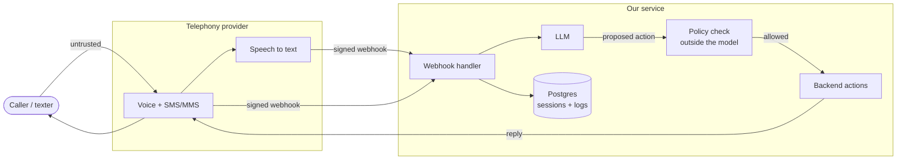

# Architecture and trust boundaries

This is the general shape of an LLM phone and SMS assistant, with the trust boundaries marked. The numbers in brackets point back to the risks in the main README.

## Where the boundaries are

**Caller to provider.** Anything the caller says, types or attaches is untrusted. That includes caller ID, which can be spoofed. [1] [2] [4]

**Provider to our webhook.** The webhook is a public URL. Anyone can POST to it, so every request has to have a valid signature before we look at the body. [6]

**Webhook to the LLM.** The caller's text goes into the model as user content, never mixed into the system prompt. Each phone number gets its own session and the model never sees another caller's history. [1] [3]

**LLM to backend actions.** This is the one that matters most. The model can only *propose* an action. A plain code check decides if it runs: is this action allowed at all, is the destination number on the allowlist, is this number over its rate limit, is the daily spend over budget. The model can't talk its way past an `if` statement. [1] [5]

**Everything to the database.** Logs store masked numbers and only what's needed for support and detection. Raw transcripts get a retention limit. [7]

## What I'd log

These are the fields the detection rules in [`detections/`](../detections) expect. One JSON line per event.

| Field | Example | Why |
|-------|---------|-----|
| `event` | `sms.inbound`, `webhook.rejected`, `tool.blocked` | What happened |
| `channel` | `voice`, `sms`, `mms` | Which path |
| `from_hash` | `a3f9...` | Hashed caller number, so you can count per caller without storing it |
| `from_masked` | `+1506***4821` | Readable for support, not useful to an attacker |
| `to_country` | `CA` | Toll fraud shows up as odd destination countries |
| `tool` | `send_sms` | Which action the model asked for |
| `decision` | `allowed`, `blocked` | What the policy check said |
| `reason` | `rate_limit`, `not_allowlisted` | Why it was blocked |
| `injection_flag` | `true` | Input matched a known injection pattern |
| `cost_cents` | `4` | Spend per event, for budget alerts |
| `src_ip` | `203.0.113.7` | For rejected webhooks |

## Things I'd do differently on a real build

- Put the policy check in its own small service so it can be tested and reviewed on its own.
- Ship logs to a SIEM instead of only keeping them in Postgres.
- Use the provider's own spend limits as a second cap, not just ours.
